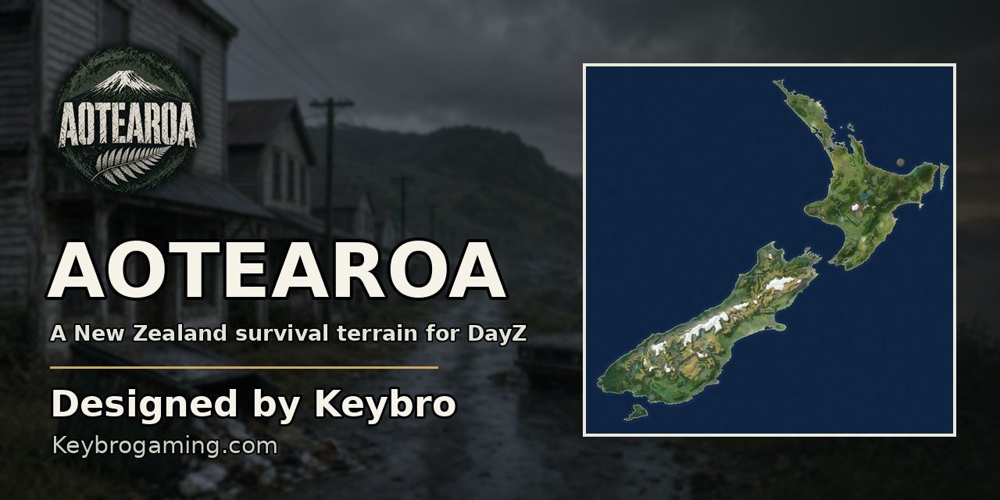
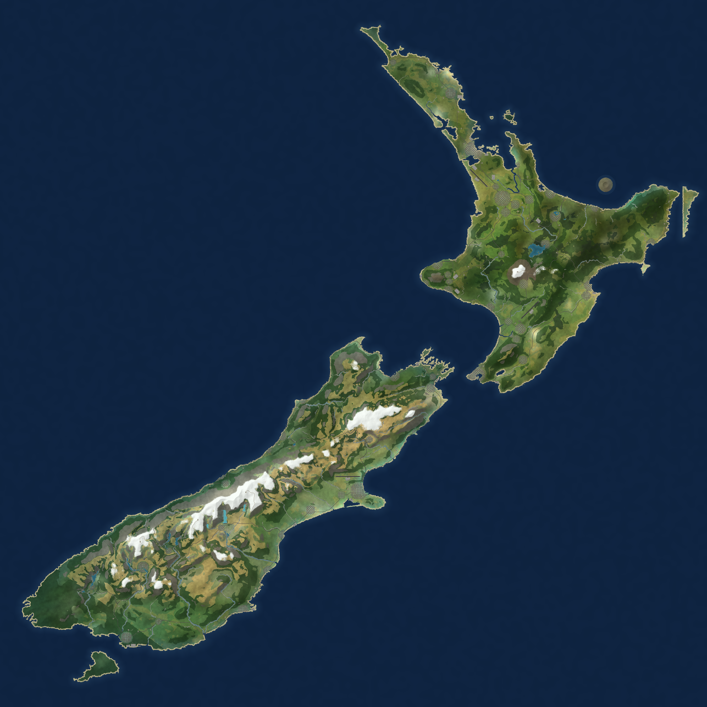
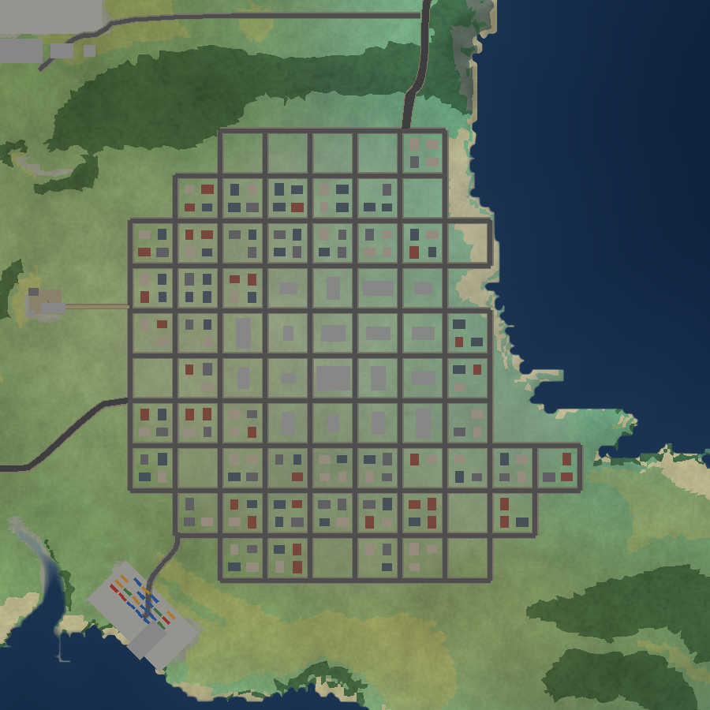
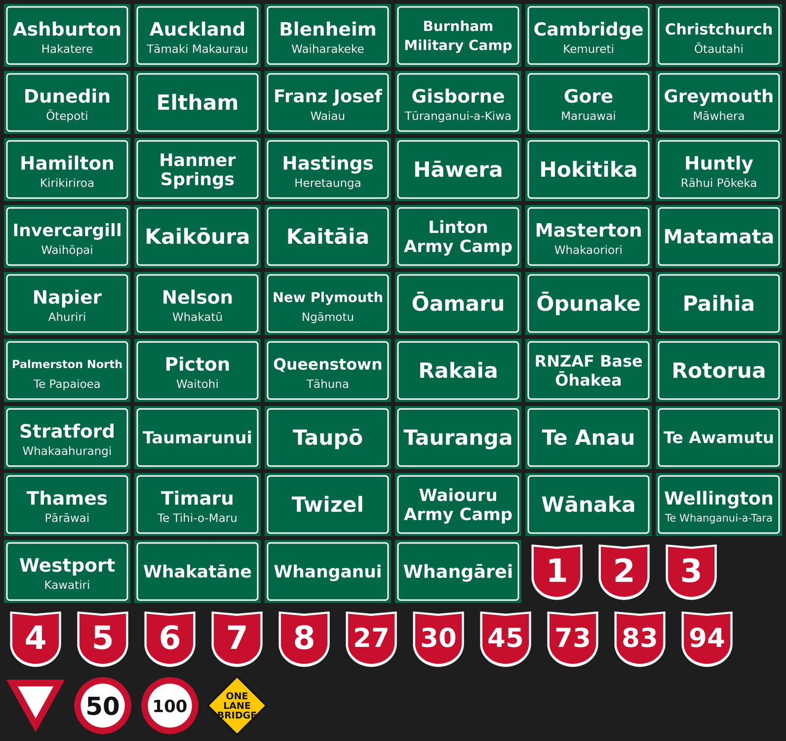
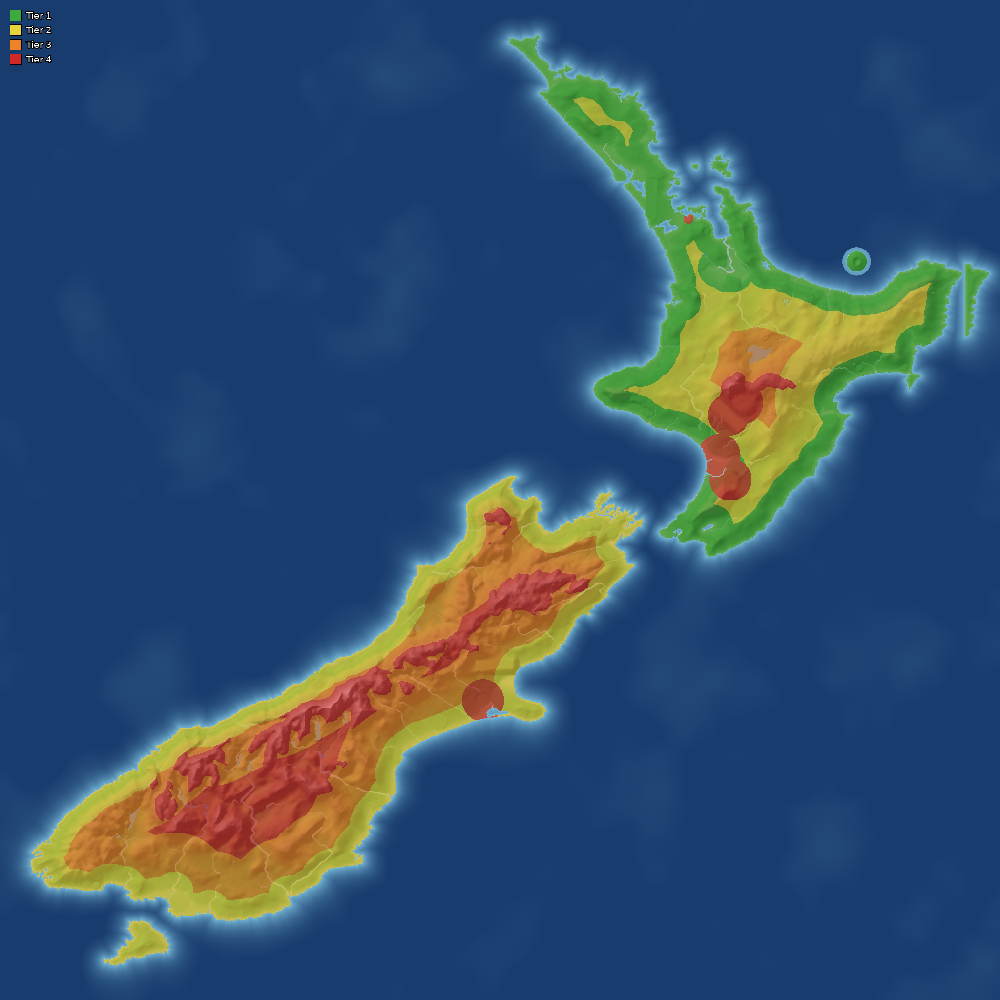
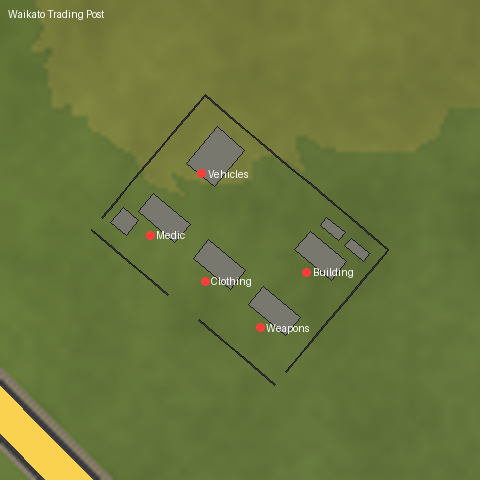
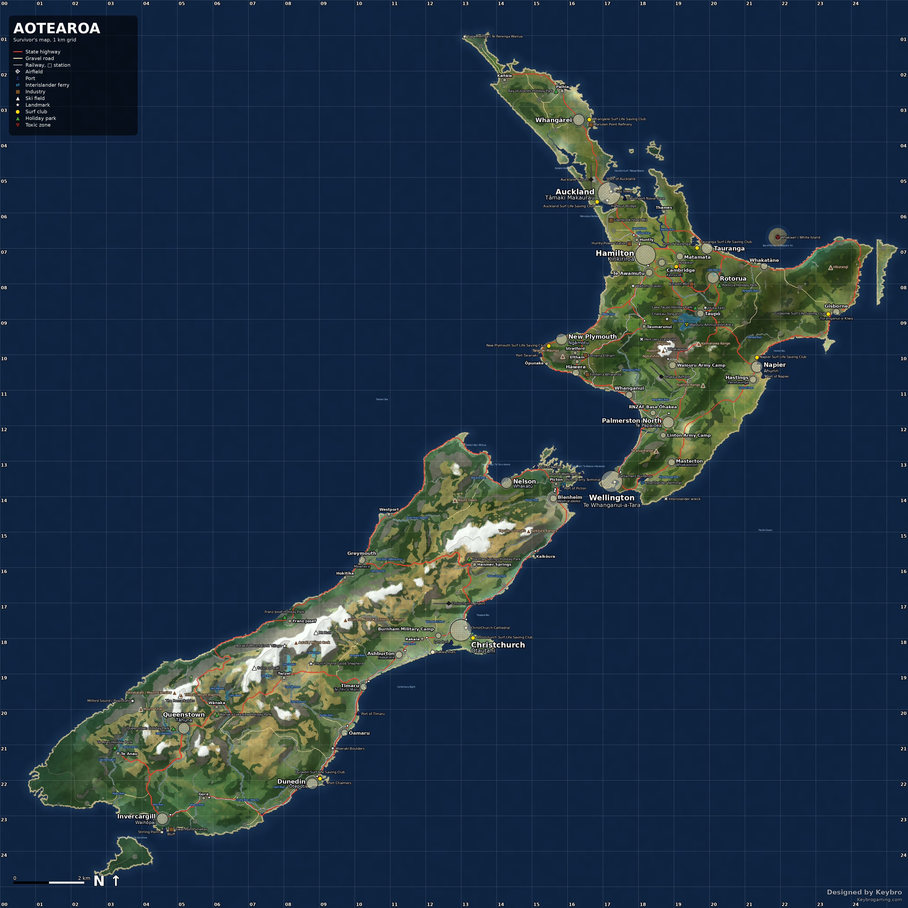
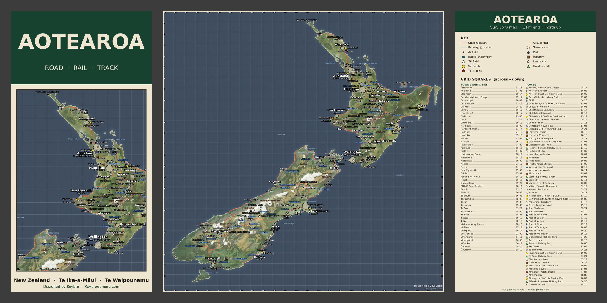

# Aotearoa (DayZ terrain)

Designed by Keybro, [Keybrogaming.com](https://keybrogaming.com).

A 25.6 km DayZ terrain based on New Zealand, for a new server. The coastline and the big landforms come from real elevation data, so you can pick out the Southern Alps, Fiordland, the Canterbury Plains, Banks Peninsula, the central volcanic plateau with Ruapehu, Ngauruhoe and Tongariro, Mt Taranaki and Stewart Island. On top of that the repo generates:

- 51 towns and bases with bilingual labels, plus 45 small hamlets in the countryside
- state highways, gravel back roads and town streets, with bridges, guardrails and power lines
- the North Island Main Trunk and Main North Line railways, with 18 stations
- lakes with water surfaces, and rivers
- landmarks: Milford Sound, Aoraki / Mount Cook Village, Chateau Tongariro, Waitomo Caves, Huka Falls, the Church of the Good Shepherd, Moeraki Boulders and Stirling Point
- airfields, ports, the Interislander ferry terminals, boat ramps, ski fields, industrial plants, Devonport Naval Base, the Cape Reinga lighthouse, Hobbiton, farms and Whakaari / White Island
- baches, surf clubs, holiday parks and DOC huts
- forests, hedgerows, farm fences and rocks; street lamps, bus stops, back fences, garden trees and abandoned cars
- a satellite texture coloured from a real satellite photo
- the server mission files: spawns, loot positions and tiers, New Zealand loot changes, animals, weather, starting gear, server messages and launch scripts
- a printable player map, a logo and loading screens, and map checks that run on GitHub. The loading screens, map picture, player map, map item, Steam Workshop image and the in-game map screen carry a "Designed by Keybro" and Keybrogaming.com watermark (`tools/watermark.py`, `scripts/5_Mission/AotearoaMapMenu.c`)



## Quick start (Windows)

1. Install [Python 3.10 or newer](https://www.python.org/downloads/) and tick "Add python.exe to PATH".
2. Double-click `setup.bat` once.
3. Double-click `build_all.bat`. It writes the large files that are too big to commit:
   - `source\heightmap_4096.asc`
   - `source\mask_25600.png`
   - `source\satellite_25600.png`
   - the mission files

   It takes about 25 minutes and 8 GB of memory. Run `build_all.bat regen` to rebuild the whole terrain from the elevation data first.
4. Follow the step-by-step checklist in [docs/TERRAIN_BUILDER_GUIDE.md](docs/TERRAIN_BUILDER_GUIDE.md). It covers Terrain Builder, packing and a test server. The sections below are the short version.

## Scale

| | |
|---|---|
| Terrain size | 25600 m x 25600 m |
| Heightmap grid | 4096 x 4096, 6.25 m cells |
| Real to game | 1 game metre is about 60 real metres north-south |
| Land area | about 108 km2 (17% of the square) |
| Highest point | 533 m (Southern Alps); Ruapehu about 455 m |
| Steepest slope | 40 degrees on dry land |

New Zealand is about 1500 km long, so a 25.6 km map shrinks it a lot, and real heights would make every range a cliff. Heights are scaled down far more than distances, then capped at 40 degrees so players can still climb the hills.

The country keeps its true north-up layout. It is stretched 1.4 times east-west, which makes the islands wider and fills the square map: the real country is about 1.4 times taller than it is wide. Change `STRETCH_X` in `tools/generate_terrain.py` to make it narrower. The settings for turning the map, bending the North Island and widening the islands along their length are still there, all switched off. `heightmap.json` records them.

The volcanoes are raised as cones so they stand out: Ruapehu (with a crater), Ngauruhoe, Tongariro and Mt Taranaki. Their upper slopes are bare volcanic ground. The cones are set in `VOLCANOES` in `tools/generate_terrain.py`.

## What's on the map

### Towns


51 places from `tools/towns.csv`, with about 2,500 buildings:

- Main cities: Auckland, Wellington, Christchurch, Hamilton / Kirikiriroa
- Cities: Tauranga, Dunedin, Palmerston North, Napier, Nelson, Rotorua, New Plymouth, Whangārei, Invercargill, Queenstown
- Towns and villages: Hastings, Whanganui, Gisborne, Blenheim, Picton, Kaikōura, Taupō, Timaru, Ōamaru, Greymouth, Westport, Hokitika, Franz Josef, Masterton, Ashburton, Wānaka, Te Anau, Gore, Twizel, Hanmer Springs, Kaitāia, Paihia, Whakatāne, Thames, Taumarunui, Eltham, Hāwera, Stratford, Ōpunake, Cambridge, Te Awamutu, Matamata, Huntly
- Military bases: Waiouru Army Camp, Burnham Military Camp, RNZAF Base Ōhakea, Linton Army Camp

Map labels show both names where a town has a separate te reo Māori name, for example "Christchurch / Ōtautahi" and "Queenstown / Tāhuna". Places whose name is already Māori, like Rotorua and Taupō, show one name. Edit the `maori` column in `tools/towns.csv` to change a label.

Each town is placed from its real latitude and longitude:

- A coastal town is moved inland until at least 70% of it is on land.
- Where two towns would overlap, the smaller one moves up to 300 m away from the larger. If they still overlap, both shrink.
- The ground is flattened to a tilt of 3 degrees or less.
- Buildings sit on a grid of 45 m blocks with 12 m streets. Hospital, police, fire station, church and pub are nearest the middle, then tenements and offices in the cities, then houses.

Between the named towns are 45 unnamed hamlets of about a dozen houses each, on gentle ground away from the coast. They have no map label and no specials, and gravel roads join them to their neighbours. Set `HAMLET_COUNT` in `tools/towns.py`.

Towns are much bigger than true scale would give, so they're worth looting. To add, remove or resize a place, edit `tools/towns.csv` (tiers: `capital`, `city`, `town`, `village`, `military`) and regenerate.

Close-ups (1 px per metre): [Auckland](preview/town_auckland.png), [Wellington](preview/town_wellington.png), [Christchurch](preview/town_christchurch.png), [Hamilton](preview/town_hamilton.png), [Queenstown](preview/town_queenstown.png).

### Roads


There are 122 km of state highway, 183 km of town streets, 26 km of gravel back roads and 41 km of tracks to sites. Highways follow the real links:

- SH1 the length of both islands, through Huntly, Cambridge, Waiouru, Burnham and Ōhakea
- SH2 round the east coast
- SH3 through Te Awamutu and south Taranaki, SH45 round the Taranaki coast, SH27 through Matamata, SH57 to Linton, and SH4 and SH5 in the North Island
- SH6 down the West Coast and over Haast Pass to Wānaka and Queenstown
- SH7 over Lewis Pass and SH73 over Arthur's Pass
- SH8 and SH83 through the Mackenzie Country
- SH94 to Te Anau, plus a few links between

Each leg is a least-cost route. It prefers grades under 8%, never crosses the sea or a lake, avoids crossing rivers, enters towns along their streets, and reuses roads already built so highways share corridors. Highways outside towns are cut into the terrain as a smooth road bed.

Gravel back roads join each hamlet, village and town to its two nearest neighbours within 3.5 km. They reuse the highways where they can, so only the stretches off the sealed network become gravel.

- `data/roads/roads.shp` holds the centrelines in Terrain Builder coordinates. The `ID` field picks the road type in `data/roads/RoadsLib.cfg` (1 highway 8 m, 2 street 6 m, 3 track 4 m, 4 gravel 5 m), and the `REF` field holds the highway number or town.
- `config.cpp` points `newRoadsShape` at the shapefile for the in-game map.
- Terrain Builder draws the road surfaces from the shapefile and `RoadsLib.cfg`. The satellite also has every road painted on, so roads show even before then.
- `source/roads.json` has the same lines, plus every point where a road crosses a riverbed. Each crossing gets a bridge (see [World detail](#world-detail)), and the riverbed is left open under it instead of being filled by the road bed.

### Railway

There are 38 km of decorative railway on two lines, with a station just outside each town on the line:

- North Island Main Trunk: Auckland, Huntly, Hamilton, Te Awamutu, Taumarunui, round the west side of Ruapehu to Waiouru, then Palmerston North and Wellington
- Main North Line and Main South Line: Picton, Blenheim, Kaikōura, Christchurch, Ashburton, Timaru, Ōamaru, Dunedin, Gore and Invercargill

The lines are routed for gentle grades (they cost four times as much per extra 2.5% of grade), stay out of towns, and are cut into the terrain like the highways. `source/roads.json` holds the lines under `rails` and the stations under `stations`. `source/objects/rail_tb.txt` lays 25 m track pieces along them, with bridge pieces at the 13 river crossings. Trains don't run; the track is scenery and a route to follow.

### Water

Lakes come from the real elevation data, where lake surfaces are stored perfectly flat: Taupō, Rotorua, Tarawera, Waikaremoana, Wakatipu, Wānaka, Hāwea, Te Anau, Manapōuri, Pukaki, Tekapo, Ōhau, Benmore and others. Each one is dug as a basin with a rim. `source/lakes.json` gives each lake's water level and shoreline, and `source/objects/lakes_tb.txt` tiles water planes over each lake at that level. Pukaki, Tekapo and Ōhau are painted glacial turquoise on the satellite.

River courses are traced on the real drainage (Waikato, Whanganui, Clutha, Waitaki, Rakaia, Waimakariri and more). They are cut as shallow gravel beds that always run downhill and drop below sea level at the mouth, where the sea fills them. `source/water_4096.png` has lakes in red and riverbeds in green.

### Points of interest


| Site | What's there |
|---|---|
| Auckland Airport, Christchurch Airport, Ōhakea Airfield | 900 m runway, apron, two hangars, service hangar, tower |
| 11 ports (Auckland, Wellington, Lyttelton, Port Chalmers, Tauranga, Napier, Picton, Nelson, Bluff, Timaru, Port Taranaki) | Concrete pad on the shore, container rows, warehouse |
| The Remarkables, Coronet Peak, Mt Hutt, Whakapapa | Lodge, car park and a lift line up the fall line |
| Fonterra Whareroa (near Hāwera), Fonterra Eltham | Dairy factories: concrete yard, three warehouses, a big shed, office and containers |
| Marsden Point Refinery | Storage tanks, workshop, warehouse and office |
| Huntly Power Station | Power station, stack, transformer, workshop and office |
| Glenbrook Steel Mill, Kinleith Mill | Three long sheds, stack, workshop and office |
| Tiwai Point Smelter | Four potline sheds, transformer and office |
| Devonport Naval Base | Waterfront pad with barracks, guardhouse, tower, warehouse and containers |
| Cape Reinga / Te Rerenga Wairua | Lighthouse at the top of the North Island |
| Milford Sound / Piopiotahi, Aoraki / Mount Cook Village | Lodge (pub), three houses, shed and car park |
| Chateau Tongariro | Vanilla's grand hotel at the foot of Ruapehu |
| Waitomo Caves, Huka Falls | Visitor centre, shed and car park |
| Church of the Good Shepherd | The little church by Lake Tekapo |
| Moeraki Boulders | Boulders scattered along the beach, with a shed and car park |
| Stirling Point | The café and shed at the bottom of the South Island, at Bluff |
| Hobbiton | A ring of cottages and the Green Dragon (hobbit holes need a custom model) |
| 70 farms | Farmhouse, barn or cowshed and shed, along the highways |
| Whakaari / White Island | Volcanic islet off the Bay of Plenty with a crater and a contaminated zone |
| Interislander Terminal (Wellington), Picton Ferry Terminal | Port-sized pad with warehouse, office, tower and containers. Three boats spawn off each, for crossing Cook Strait. |
| 16 boat ramps | A ramp into the sea or lake and a shed, near Paihia, Whangārei, Thames, Whakatāne, Gisborne, Ōpunake, Kaikōura, Westport, Greymouth, Ōamaru, Te Anau, Taupō, Wānaka, Queenstown, Picton and Nelson. Each gets a boat where the water is deep enough. |
| 8 surf clubs | Clubhouse and shed behind the beach near the big coastal cities |
| 8 holiday parks | Office, shed and tents at Taupō, Rotorua, Wānaka, Te Anau, Queenstown, Hanmer Springs, Franz Josef and Paihia |
| 14 bach clusters | Rows of four holiday homes behind quiet beaches, away from the towns |
| 15 DOC huts | A small hut and woodshed on flat benches high in the ranges |
| 18 railway stations | A station building beside the line at each town on the railway |

### Landmarks, wrecks and bases

`tools/setpieces.py` adds set pieces built only from vanilla objects, so they need no custom models. `build_mission.py` places them on flat, clear ground after the towns and sites:

| Set piece | What's there |
|---|---|
| Sky Tower | Vanilla's TV tower, all three pieces stacked (about 150 m), in central Auckland |
| Harbour Bridge | Steel truss spans over the shortest water crossing near Auckland's centre |
| Parliament Buildings | The municipal office and an office block in Wellington, both lootable |
| ChristChurch Cathedral | A ruined church in Christchurch, after the 2011 earthquake |
| Interislander wreck | The big ship wreck aground in the shallows off Wellington, like the Wahine in 1968, with a lifeboat on the beach |
| Hercules crash site | A crashed C-130 1 to 2.6 km from Ōhakea |
| Waiouru, Burnham, Linton, Ōhakea | Extra barracks, tents, guardhouses and towers round each base. Military infected, tier 4 loot. |
| Waiouru Ammunition Area | Bunkers, a fortified nest and towers in the desert east of the camp, inside a 200 m static gas zone |

They go to `source/objects/setpieces_tb.txt` for Terrain Builder and to `setpieces_spawner.json`, which `pack.bat` adds to the mission's object spawner so they appear before the world is rebuilt (pass `--setpieces-in-wrp` once they are in the world). They are on the 2D map, the player map and the map item's legend.

Every site is fitted onto dry, open land clear of towns, roads and water, flattened, and joined to the nearest road. Labels for the named sites are in `config/names.hpp`. Close-ups: [Christchurch Airport](preview/satellite_christchurchairport.png), [Lyttelton](preview/satellite_lyttelton.png).

### World detail

Each group is its own Terrain Builder import in `source/objects/`, so you can bring them in as separate layers or leave any out. `tools/details.py` makes them.

| File | What |
|---|---|
| `bridges_tb.txt` | 25 m bridge pieces across every river crossing. Each piece is lifted to the road on the banks. |
| `lakes_tb.txt` | 50 m water planes over each lake. The last field is the absolute water level, not an offset. |
| `powerlines_tb.txt` | Wooden poles every 40 m, 14 m beside the highways, outside towns |
| `guardrails_tb.txt` | Rails where the ground falls more than 3 m beside a highway, and on bridge approaches |
| `fences_tb.txt` | A fence round every farm yard, with a gate gap |
| `hedgerows_tb.txt` | Bush hedges in runs along highways through pasture and farmland |
| `rocks_tb.txt` | Boulders on slopes over 34 degrees and stones in the riverbeds |
| `rail_tb.txt` | Railway track pieces and rail bridges |
| `wrecks_tb.txt` | Abandoned cars on the highway verges |
| `streetlamps_tb.txt` | Street lamps every 32 m along the town streets |
| `busstops_tb.txt` | A bus shelter on the longest street of each town |
| `townwrecks_tb.txt` | Abandoned cars at the kerb in town streets |
| `gardenfences_tb.txt` | A back fence behind each house |
| `gardentrees_tb.txt` | Fruit and birch trees in the back gardens |

There are about 70 road bridge pieces over 41 crossings, 270 lake tiles, 990 power poles, 1,500 guardrail pieces, 3,500 farm fence panels, 14,100 hedge bushes, 21,000 rocks, 1,550 rail pieces, 300 wrecks, 4,000 street lamps, 47 bus stops, 6,800 garden fence panels and 1,300 garden trees.

### Forests


There are about 365,000 trees and bushes. Native bush is an irregular mix of broadleaf trees with an understorey and a bushy edge. Pine is planted in straight rows like radiata plantations, with each stand turned its own way. Trees stay off roads, towns, sites, water and slopes over 38 degrees.

### Surfaces

| Layer | Colour | Where |
|---|---|---|
| beach | 255,230,140 | Low coast up to 45 m inland, lake beds, and everything under the sea |
| pasture | 120,190,60 | Default lowland grass, and the ground inside towns |
| farmland | 200,200,90 | Flat low ground, e.g. Canterbury and Waikato |
| bush | 20,90,30 | Steep hills and the wet West Coast |
| pine | 60,110,70 | Plantation forest in the North Island hills |
| tussock | 190,160,80 | South Island high country east of the main divide |
| scree | 150,150,150 | High alpine ground, riverbeds, runways and yards |
| rock | 90,80,75 | Anything steeper than 36 degrees |
| volcanic | 120,60,50 | Central plateau and Whakaari |

The material paths in `layers.cfg` point at vanilla `DZ\surfaces\data\terrain` files. Check that each one exists on your P: drive before you generate layers, and swap any that don't. Terrain Builder allows only a few surfaces per tile, so if layer generation reports too many surfaces on a tile, merge similar layers (for example, farmland into pasture).

### Satellite texture



A satellite photo is far too coarse to use directly: at 25.6 km, one pixel of a full-country photo covers about 30 m of the map. So the photo supplies the regional colour (olive Waikato, brown Canterbury and Otago high country, dark Fiordland), and each surface layer adjusts it. On top of that the builder adds:

- light and shade from the heightmap
- small-scale texture and canopy speckle
- snow above about 330 m
- sea and lake colour by depth, and braided water in the riverbeds
- roads, runways with markings, port pads and yards
- a rooftop for every building

The photo is not stored in this repo; only the colours taken from it are. To use a different north-up photo of New Zealand, run `python tools/sample_photo_colours.py photo.png`, then `build_satellite.py`. It prints how well the coastlines matched (the current photo matched 0.92 out of 1). The style of each layer is set in `LAYER_STYLE` at the top of `build_satellite.py`.

## Files

| Path | What it is |
|---|---|
| `config.cpp`, `$PBOPREFIX$` | World config (`CfgWorlds` class `aotearoa`) and PBO prefix `maps\aotearoa` |
| `config/names.hpp` | Map labels for towns and sites |
| `mod/mod.cpp` | Mod name and description for the `@Aotearoa` folder |
| `data/roads/` | `roads.shp` and `RoadsLib.cfg` |
| `data/branding/` | Logo, icons, loading screens and the map picture, with the source art in `art/` |
| `source/heightmap_4096.png` | 16-bit heightmap. Black is `png_black_m` and white is `png_white_m` in `heightmap.json`. |
| `source/heightmap.json` | Height range, grid, projection and reshape details |
| `source/mask_4096.png`, `source/layers.cfg`, `source/mapLegend.png` | Surface mask, its layers and legend |
| `source/water_4096.png`, `source/lakes.json` | Lakes and riverbeds; lake levels and shorelines |
| `source/roads.json`, `source/roads_4096.png` | Road lines and bridge points; road footprint |
| `source/pois.json` | Sites, their paved areas, lift lines and the Whakaari zone |
| `source/towns.csv` | Generated town positions in world and Terrain Builder coordinates |
| `source/objects/*_tb.txt` | Terrain Builder object imports: towns, sites, forest and the world detail groups |
| `source/objects/*_spawner.json` | Town and site buildings as DayZ object spawner files. Not used by default, because the buildings are already in the world; `pack.bat --spawners` loads them for a quick test on a world without the Terrain Builder objects. |
| `source/sat_tint_512.png` | Regional colour taken from the satellite photo, in map space |
| `mission/` | Server mission files, a `serverDZ.cfg` template and launch scripts in `mission/server/` |
| `preview/` | Satellite, relief, mask, slope, towns, roads, sites, forest, mission maps and the player map |
| `.github/workflows/check.yml` | Runs `tools/check_map.py` on every push |
| `.github/workflows/release.yml` | Builds a GitHub release when a `v*` tag is pushed |
| `VERSION`, `CHANGELOG.md` | The current version and what changed in each |
| `docs/` | The Terrain Builder walkthrough and the custom models plan |
| `tools/` | The generators (see [Regenerating](#regenerating)) |

Not committed, because they are too big: `source/heightmap_4096.asc` (about 120 MB), `source/mask_25600.png` and `source/satellite_25600.png`. `build_all.bat` makes them.

## Terrain Builder setup

These steps assume DayZ Tools is installed and the P: drive is mounted with game data extracted.

1. Copy this repo to `P:\maps\aotearoa` and run `build_all.bat`.
2. In Terrain Builder, create a new project at `P:\maps\aotearoa\source`.
3. Open **Mapframe Properties** and set:
   - Location: easting **200000**, northing **0**
   - Samplers: grid size **4096 x 4096**, cell size **6.25 m**, terrain size **25600 m**
   - Satellite and surface mask image size: **25600 x 25600** (1 m per pixel)
   - Tile size **512**, desired overlap **16**
   - Output root: `P:\maps\aotearoa\data\layers`
4. **Import Terrain** and choose `source\heightmap_4096.asc`.
5. Import `source\satellite_25600.png` as the satellite image and `source\mask_25600.png` as the surface mask.
6. Point the layers config at `source\layers.cfg`.
7. **Import Objects** from each file in `source\objects`:
   - `towns_tb.txt`
   - `pois_tb.txt`
   - `forest_tb.txt` (large, so give it a layer of its own)
   - `bridges_tb.txt`, `powerlines_tb.txt`, `guardrails_tb.txt`, `fences_tb.txt`, `hedgerows_tb.txt`, `rocks_tb.txt`
   - `rail_tb.txt`, `wrecks_tb.txt`
   - `streetlamps_tb.txt`, `busstops_tb.txt`, `townwrecks_tb.txt`, `gardenfences_tb.txt`, `gardentrees_tb.txt`
   - `lakes_tb.txt`, with absolute heights, since its last field is the water level

   Do this once your template library has the models.
8. Import `data\roads\roads.shp` into the roads layer with `data\roads\RoadsLib.cfg`.
9. **Generate Layers**, then **Export WRP** to `P:\maps\aotearoa\world\aotearoa.wrp`.

## Packing the mod

**One click:** once the world is exported, double-click `pack.bat` (or `pack.bat --key aotearoa --zip` to sign and zip). It converts the branding to `.paa`, packs `aotearoa.pbo` with Addon Builder, signs it, and writes:

- `dist\@Aotearoa\`: the mod for clients and the server
- `dist\server\`: a ready server folder. It holds the mod, keys, `serverDZ.cfg`, the launch scripts, and `mpmissions\dayzOffline.aotearoa`, which is vanilla Chernarus with every Aotearoa file copied over it and `cfggameplay.json` and `cfgeconomycore.xml` already merged. Copy its contents into your DayZ Server folder.

**Loot density:** Aotearoa has 88,195 loot points, 52% of Chernarus's. At vanilla amounts, every building would hold about twice the loot. So `pack.bat` first scales loot by 0.52, which gives each building about the same loot as on Chernarus. It works the factor out from `mapgrouppos.xml` and the vanilla per-building counts in `tools/loot_points.json`. Pass `--vanilla-loot` to keep vanilla amounts.

**Difficulty:** `pack.bat --difficulty easy` or `--difficulty hard` then scales the amounts in the server folder. Normal keeps the vanilla feel.

| | Loot (after the density factor) | Vehicles | Infected |
|---|---|---|---|
| easy | x1.5 | x1.5 | x0.6 |
| normal | x1 | x1 | x1 |
| hard | x0.6 | x0.6 | x1.5 |

Loot scales every item's `nominal` and `min` in `types.xml`. `--loot X` sets the whole loot factor and replaces the density factor. Vehicles scale the `Vehicle*` events in `events.xml`. Infected scale the `Infected*` events and `ZombieMaxCount` in `globals.xml`. Fine-tune any one with `--loot`, `--vehicles` or `--infected` and a factor, for example `pack.bat --difficulty hard --vehicles 1`.

**Road signs:** every road into a named town gets a green New Zealand place-name sign, with the Māori name below where the town has one. The map also has State Highway shields, 50 and 100 km/h signs at town edges, Give Way signs where side roads meet highways, and One Lane Bridge signs. That's 797 signs in all, each on the left verge facing its traffic. The textures, config classes and positions are generated already. They need two simple models, which you make from `docs/models/sign_town.obj` and `sign_post.obj` (see [docs/CUSTOM_MODELS.md](docs/CUSTOM_MODELS.md), item 2). Until those exist, `pack.bat` leaves the signs out and says so.

**Custom buildings:** `tools/make_models.py` writes enterable blockout models, ready to import into Object Builder, for a Kiwi bach, a DOC hut, a woolshed and a corner dairy, with their textures and config classes. See [docs/CUSTOM_MODELS.md](docs/CUSTOM_MODELS.md).



It finds DayZ Tools and the DayZ Server's vanilla mission in their Steam folders; pass `--tools` or `--vanilla-mission` if yours are elsewhere. Run `python tools/pack_mod.py --help` for all options. The signing key goes in `keys\` and is never committed.

By hand:

1. In Addon Builder, pack `P:\maps\aotearoa` to `@Aotearoa\addons\aotearoa.pbo` with the prefix `maps\aotearoa`.
   - Leave out `source\`, `tools\`, `preview\` and `mission\`. They are inputs, not game data.
   - Keep `config.cpp`, `config\`, `data\`, `structures\` and `world\`.
2. Copy `mod\mod.cpp` into `@Aotearoa\`.
   - Before packing, convert the images in `data\branding\` with ImageToPAA from DayZ Tools. `logo_512.png` and the icons become `logo_512_ca.paa`, `icon_128_ca.paa` and `icon_64_ca.paa` (they have alpha). `loading_1.jpg` and `map_picture.jpg` become `loading_1_co.paa` and `map_picture_co.paa`. `mod.cpp` and `config.cpp` point at those names.
3. Sign the PBO with your key if the server verifies signatures.

The world inherits lighting and sounds from Chernarus Plus. It sets a southern latitude (41.5 degrees south) and a 25.6 km map grid.

### Wildlife, weather and events

**Wildlife:** no wolves, bears, roe deer or foxes. `pack.bat` turns those events off in the server's `events.xml` and raises sheep to 14 herds, red deer 16, goats 12, cattle 10 and wild pigs 10. Red deer keep mostly to the bush above 100 m (65% of herds), goats to steep bush, tussock and scree.

**Weather and seasons:** the mod's world scripts (`scripts/4_World/AotearoaData.c`) give the map its own climate. Months follow the server date, so July is winter: lows of 1 degree in July to 12 in January and highs of 10 to 23 degrees (roughly Canterbury), short winter days (sunrise 8:00, sunset 17:10) and long summer ones (6:05 to 21:00). Temperature drops 4 degrees per 100 m of height, so the Southern Alps are freezing (the game's heights are about a seventh of the real ones). Westerly fronts bring rain most days, spring is the most changeable, and winter storms bring light snow. DayZ has one snowfall for the whole map, so it falls everywhere then; the snowcaps on the Alps are painted on the satellite texture.

**Events:** five military convoys sit on the roads round each base, police roadblocks close the highway into each city and town, pile-ups block State Highway 1 and the other highways, and twelve derailed trains lie on the main lines. Heli crashes, convoys, roadblocks, police cars and trains are all more common than on Chernarus.

**Contaminated zones:** static gas covers Whakaari and the Waiouru Ammunition Area. The dynamic gas event (vanilla's) drops zones at the bases, airfields, industrial sites and ports, and in open back country.

## Server setup

`tools/build_mission.py` (step 5 of `build_all.bat`) writes `mission/dayzOffline.aotearoa`:

| File | What it holds |
|---|---|
| `init.c` | Vanilla start-up, with real southern seasons from the server date (set `pin_month` to fix one month) and the loot export line (see below) |
| `cfgplayerspawnpoints.xml` | 40 spawn bubbles spread along the coasts of the two main islands |
| `cfgeventspawns.xml` | Cars on the highway verges and parked in town streets, farm utes and trucks on the back roads and farm tracks, boats off the ports, ferry terminals and boat ramps, heli crashes in open country, police cars in town streets, military convoys near the bases, police roadblocks on the highways into the cities and towns, pile-ups on State Highway 1 and the other highways, derailed trains on the main lines, motorbikes and plank piles, and the dynamic gas zones |
| `cfgeventgroups.xml` | The convoy, roadblock, pile-up and train groups those events spawn (`tools/event_groups.py`) |
| `env/zombie_territories.xml` | Infected zones: city, village and army in towns, police at police stations, medics at hospitals, firefighters at fire stations, priests at churches, hard army at Waiouru, village in hamlets, surf clubs, holiday parks and stations, industrial at ports, the ferry terminals and airfields, solitude at farms, baches and huts |
| `cfgEffectArea.json` | The Whakaari and Waiouru Ammunition Area contaminated zones and their safe positions |
| `cfggameplay.worldsdata.json` | Settings to merge into `cfggameplay.json`: New Zealand temperatures and the starting gear |
| `mapgrouppos.xml` | Every town and site building, so loot spawns from the first start |
| `aotearoa_ce/types.xml`, `cfgeconomycore.aotearoa.xml` | New Zealand loot changes (79 items): hunting rifles, shotguns, .22 and .308 ammo on farms; NZDF Steyr AUGs, M4s and FALs at the bases; handguns rare except police Glocks; honey, milk powder and canned fish; fishing, fencing and tramping gear; gumboots, raincoats, jumpers and beanies |
| `loot_tiers.json` | The loot tier of every town and site |
| `env/*_territories.xml` | Animals: red deer and wild pigs in the bush, sheep on pasture and goats in the high country, cattle, pigs and hens at farms, hares on farmland. No wolves, bears, foxes or roe deer. |
| `cfgweather.xml` | Windy, changeable weather with frequent showers and light fog (the seasons come from the world scripts, see below) |
| `aotearoa_spawngear_*.json` | Starting gear presets: Farmer (checked shirt, jeans, gumboots), Tramper (rain jacket, cargo pants, hiking boots) and Beach (T-shirt, shorts, sneakers). Each has a rag, a chemlight and an apple. |
| `db/messages.xml` | A "Kia ora" welcome, a tip about the ferries, server rules every 30 minutes, and a restart countdown for 4-hourly restarts. Edit `RULES` in `tools/server_files.py` for your own rules. |
| `../server/start_server.bat`, `../server/start_server.sh` | Launch loops for Windows and Linux that restart the server when it stops |
| `../server/ban.txt`, `../server/whitelist.txt` | Empty ban and whitelist files with the format explained. The whitelist only applies once you set `enableWhitelist = 1` in `serverDZ.cfg`. |
| `../server/battleye/BEServer_x64.cfg` | BattlEye RCon settings (password and port 2306) for admin tools. It goes in `profiles\BattlEye\`; `pack.bat` puts it there. |



Loot tier 1 is the northern coasts. Tiers rise inland, southwards and above 300 m. Military bases and 150 m round them, Ōhakea and Devonport are tier 4. Civilian towns are capped at tier 3, so towns next to a base (Palmerston North, Rakaia) or high in the Alps (Queenstown, Twizel) don't have military loot in every house. DayZ reads tiers from `areaflags.map`, which you paint in the DayZ Tools economy editor. Use `preview/loot_tiers_2048.png` as the guide for the Value layer.

`mission/serverDZ.cfg` is a server config template pointing at the mission.

To set up a server:

1. Copy vanilla `mpmissions\dayzOffline.chernarusplus` to `mpmissions\dayzOffline.aotearoa`. Copy the generated files over it.
2. Merge `cfggameplay.worldsdata.json` into the mission's `cfggameplay.json`. It sets the temperatures under `WorldsData` and the starting gear under `PlayerData.spawnGearPresetFiles`. (`pack.bat` does this step and steps 1 and 4 for you.)
3. Copy `mission\serverDZ.cfg` and `mission\server\start_server.bat` (or `.sh` on Linux) next to the server executable. Set `passwordAdmin` and run the script. It starts the server with `-mod=@Aotearoa` and restarts it when it stops.
4. Paste the `<ce>` block from `cfgeconomycore.aotearoa.xml` into `<economycore>` in `cfgeconomycore.xml`.
5. Paint `areaflags.map` using the tier map (see above). Keep vanilla `cfgenvironment.xml`; the generated `env\` files replace its territories.
6. Once the world is built, refresh the loot positions:
   1. Uncomment the `ExportProxyData` line in `init.c`.
   2. Start the server once.
   3. Copy `storage_1\export\mapgrouppos.xml` over the generated one.
   4. Comment the line out again.

   The generated `mapgrouppos.xml` works until then. The export gives exact positions.

The rest of the economy is vanilla. Each entry in `NZ_TYPES` in `tools/economy.py` changes only the count, minimum, usages and tiers of the vanilla entry, kept in `tools/vanilla_types.xml`; lifetimes, quantities, flags and shelf tags stay vanilla. After a DayZ update, run `python tools/refresh_vanilla_types.py` (or pass `--xml` with your server's `db/types.xml`) and rebuild the mission. The map checks reject unknown items, usages or tiers.

### Traders, safe zones and server mods



`tools/mod_support.py` (run by `build_mission.py`) picks four trader sites on flat, clear land away from towns and sites:

| Site | Type |
|---|---|
| Waikato Trading Post | Safe zone, between Auckland and Hamilton, by SH1 |
| Central Plateau Trading Post | Safe zone, outside Taupō |
| Rakaia Trading Post | Safe zone, between Christchurch and Ashburton |
| Mackenzie Black Market | No safe zone, up a back road near Twizel, 30% dearer |

Each site has a fenced compound of vanilla tents, a vehicle shed and containers. No car spawns inside a safe zone.

| `pack.bat` option | What it does |
|---|---|
| `--traders` | Loads the compounds. Works on any server, with no mods. |
| `--expansion` | DayZ Expansion: adds trader NPCs and trader zones, plus safe zone and spawn region snippets to paste in |
| `--traderplus` | TraderPlus: adds trader and safe area snippets to paste in |

Code Lock, BaseBuildingPlus and similar mods need nothing map-specific. [mission/mods/README.md](mission/mods/README.md) has the coordinates and the install steps for each mod.

### Balance and performance

`tools/balance_report.py` writes [docs/BALANCE_REPORT.md](docs/BALANCE_REPORT.md) and `preview/balance_2048.png`. The report covers:
- objects per 250 m cell, against a 1,500 limit;
- how many objects the spawners send at login;
- loot buildings by tier and town;
- the distance from any land to the nearest vehicle;
- infected zones.

Right now nothing is over its limit. The busiest cell has 986 objects and the spawners send 962 objects. `build_mission.py` adds farm utes wherever land is more than 1 km from a vehicle; the worst gap is now 1.06 km (was 1.7 km). Loot is scaled to the map's loot points (see "Loot density" above).

## Player map



`preview/player_map_4096.jpg` is a labelled map to print or share with players. It has the satellite image, a 1 km grid numbered like the in-game map, towns with both names, the highways, gravel roads, railway and stations, the main sites and a legend. Make a bigger one from the full satellite with `python tools/build_player_map.py --size 8192`.

## In-game map item



The paper map players pick up is its own mod, `@AotearoaMap`, with the class **`AotearoaMap`**. It is built on vanilla `ChernarusMap`, so it unfolds the same way and keeps markers.
- **Opened sheet:** the labelled map with the 1 km grid.
- **Back (legend panel):** the key, then all 52 towns and 56 named places with their grid squares, for example `Rakaia ..... 11-18`.
- **Cover:** a folded road-map cover.

Unfolding it opens DayZ's 2D map, which the game draws from the terrain. Its labels come from `config/names.hpp`, which has 195 of them:
- every town, military camp and named site;
- from `tools/labels.py`: 24 named rivers, 16 peaks and ranges, 15 lakes, 13 seas, bays and harbours, and the 19 railway stations.

Rivers are snapped onto the traced channels, peaks to the local high point, and seas to open water. The labels use the location types that DayZ's map styles (`Capital`, `City`, `Village`, `Local`, `Marine`, `Hill`, `RailroadStation`). The rivers, peaks and seas are also drawn on the player map and on the map item's sheet. To add a feature, append it to `RIVERS`, `PEAKS` or `SEAS` in `tools/labels.py` and run `python tools/labels.py`.

| File | What it is |
|---|---|
| `mapitem/config.cpp` | `CfgPatches Aotearoa_Map`, `CfgMods` and `class AotearoaMap: ChernarusMap` |
| `mapitem/scripts/4_World/AotearoaMap.c` | Makes the item use its own name and textures. Vanilla takes them from the loaded terrain, so without it every map looks alike. |
| `mapitem/data/aotearoa_map_*.png` | The cover, sheet and legend textures, from `tools/build_map_item.py` |
| `mapitem/ce/types.xml` | Loot: `AotearoaMap` spawns where vanilla maps do, plus towns and villages. Vanilla `ChernarusMap` is set to 0. |

`pack.bat` packs it to `dist\@AotearoaMap\addons\aotearoa_map.pbo` (prefix `aotearoa_map`) and signs it with the same key. In the server folder it also:
- adds `@AotearoaMap` to the launch scripts (`-mod=@Aotearoa;@AotearoaMap`);
- copies the loot file to `aotearoa_map_ce\` and registers it in `cfgeconomycore.xml`.

Players need both mods. Pass `--no-map-item` to leave it out.

The world config also sets `mapTexture*` and `mapDisplayNameKey`. So even a vanilla `ChernarusMap` shows Aotearoa on this terrain, instead of Chernarus.

Give it to new players by adding `AotearoaMap` to a starting gear preset, or sell it at the traders.

## Steam Workshop

`workshop/` holds what to paste into the Workshop page:
- `preview.jpg`: the 1024 x 1024 preview image, with the watermark. `python tools/make_branding.py` rebuilds it.
- `screenshots/`: eight 1920 x 1080 feature cards (whole map, both islands, towns, roads and rail, Christchurch, loot, map item) with the watermark. `python tools/make_workshop_shots.py` rebuilds them from the previews; swap in in-game shots once the world is built.
- `discord_post.md`: the release post for Discord (under Discord's 2,000-character limit).
- `description.txt`: the description in Steam's BBCode, with the [Discord](https://discord.gg/FpsDrBTaX3) link and the note that the mod may not be repacked or included in server packs without permission.

`.github/banner.png` is the 1280 x 640 GitHub banner at the top of this README; upload it under Settings > General > Social preview so links to the repo show it.

In DayZ Tools Publisher, point the preview at `workshop\preview.jpg`, then paste `description.txt` into the Workshop page's description.

## Releases

Each version is a [GitHub release](https://github.com/KeybroAU/aotearoa-dayz-map/releases) with:
- the mission files
- the heightmap as `.asc`
- the player map
- the map item source (`mapitem/`)
- a source zip

To make one:

1. Add a section for the new version at the top of `CHANGELOG.md`.
2. Put the same version in `VERSION` and in `mod/mod.cpp`. The checks fail if they differ.
3. Commit, then tag and push: `git tag v0.5.0 && git push origin v0.5.0`.

GitHub runs the checks, builds the files and publishes the release with that version's changelog as its notes.

## Discord updates

`.github/workflows/discord.yml` posts every push (up to 10 commits each), pull request opened, merged or closed, and published release to Discord. It reads the channel's webhook URL from the repo secret `DISCORD_WEBHOOK` (Settings > Secrets and variables > Actions); keep the URL out of the repo, since anyone with it can post to the channel. Without the secret the job does nothing.

## Custom models

[docs/CUSTOM_MODELS.md](docs/CUSTOM_MODELS.md) is a brief for a modeller. It covers New Zealand models the map would benefit from, in priority order:
- the lake water plane and NZ road signs (the signs are placed and textured; only two simple models are left)
- a bach, a woolshed, a corner dairy and a DOC hut, each with a ready-to-import blockout from `tools/make_models.py`
- Hobbit holes, the Interislander, the Sky Tower, the Beehive and the Chateau

For each one it gives the size and the parts it needs, plus where the map uses a stand-in today.

## Checks

`tools/check_map.py` runs on GitHub on every push (`.github/workflows/check.yml`). It checks that:

- the heightmap, mask and `config.cpp` agree on size;
- every mission XML and JSON file parses;
- every building, spawn, event, sign and trader object is on the map and on land (boats on water);
- every Terrain Builder file is well formed;
- every road type has a `RoadsLib.cfg` entry;
- every sign has a config class and a texture;
- no vehicle spawns inside a safe zone.

Run it yourself after regenerating.

## Things to check on your P: drive

Class and model names here are vanilla DayZ names that haven't been checked against a real P: drive yet. If one doesn't match, Terrain Builder skips the object or the server logs a missing class.

`tools/check_models.py` does the checking for you. On the machine with the P: drive mounted, list every model:

```bat
dir /s /b P:\DZ\*.p3d > models.txt
```

Then run `python tools/check_models.py models.txt`. It lists every model the map uses that isn't on the drive, with the closest names it found. Add `--fix` to write `source/model_fixes.json` with the best guesses. Check that file, then run `--apply` to rewrite the object files. Copy the right names into the tables in `tools/` too, so the next build keeps them.

The lists are at the top of each file:

| Where | What |
|---|---|
| `tools/towns.py` | Town buildings (`Land_House_1W01` and so on). Terrain Builder uses the model name in lowercase (`land_house_1w01` becomes `house_1w01`). |
| `tools/pois.py` | Hangars, tower, containers, warehouse, barns, lift towers, tanks, power station, stacks, lighthouse |
| `tools/forests.py` | Tree and bush models from `DZ\plants` |
| `tools/pois.py` (rural sites) | Station building (`Land_Rail_Station_Big`), clubhouse, tents and sheds |
| `tools/details.py` (`OBJECTS`) | Bridge, power pole, guardrail, fence, rock, rail track and rail bridge, street lamp, bus stop, wreck and garden tree models. The rail, lamp, bus stop and wreck names are the least certain. The lake water plane (`aotearoa_water_50`) is a placeholder: vanilla DayZ has no standalone lake surface, so point it at a 50 m water plane model of your own or from a mod. |
| `tools/economy.py` | Item and animal names |
| `data/roads/RoadsLib.cfg` | Road textures and materials (placeholders) |
| `source/layers.cfg` | Surface materials |

The Terrain Builder object format is `"template";x;y;yaw;pitch;roll;scale;z offset;`, with the 200000 easting already added. Town grids and site layouts are turned in steps of 45 degrees, so buildings line up whichever way the engine counts yaw.

`config/names.hpp` is UTF-8 with macrons. If a macron shows as a box on the in-game map, the map font is missing that character. Remove the macrons from the `maori` and `name` columns in `tools/towns.csv` and regenerate.

## Regenerating

```bash
pip install -r tools/requirements.txt
python tools/generate_terrain.py      # terrain, water, towns, roads, sites, forest, 4096 mask, previews
python tools/build_satellite.py --size 25600
python tools/upscale_mask.py 25600
python tools/png_to_asc.py
python tools/build_mission.py         # mission, starting gear, messages, launch scripts
python tools/build_player_map.py      # preview/player_map_4096.jpg
python tools/make_branding.py         # data/branding from the art and the satellite preview
python tools/check_map.py
```

`generate_terrain.py` downloads [Terrarium elevation tiles](https://registry.opendata.aws/terrain-tiles/) from AWS Open Data into `~/.cache/aotearoa-tiles`. The tiles mix SRTM, GEBCO, LINZ and other sources. It takes about 5 minutes. Each part has its own module and its own settings at the top of the file:

| Module | Settings |
|---|---|
| `generate_terrain.py` | Shape and height: `STRETCH_X`, `VOLCANOES`, `ROTATION_DEG`, `NI_BEND_DEG`, `WIDEN`, `MAX_HEIGHT`, `MAX_SLOPE_DEG`, `MIDDLE_WEIGHT`, `COAST_RAMP_M`, `SEED` |
| `water.py` | Lake detection, river size (`RIVER_MIN_CATCHMENT_KM2`) and depth |
| `towns.py` | Town tiers, block size and building lists |
| `roads.py` | The highway list (`HIGHWAYS`), the railways (`RAILWAYS`), back road links, road widths and routing costs |
| `pois.py` | Airfields, ports, ferry terminals, boat ramps, ski fields, industrial sites, surf clubs, holiday parks, baches, huts, Hobbiton, Whakaari, farm count |
| `forests.py` | Tree lists and spacing |
| `details.py` | Bridge, lake, power line, guardrail, fence, hedge, rock, rail, wreck and town detail models and spacing |
| `build_mission.py` | Spawn, vehicle and crash counts, infected zone density, temperatures |
| `server_files.py` | Starting gear (`PRESETS`), server messages, restart interval and launch scripts |
| `labelplace.py` | Keeps map labels from overlapping (player map, map item, towns preview) |
| `economy.py` | Loot changes (`NZ_TYPES`), tier rules, animal herds (`HERDS`), weather |
