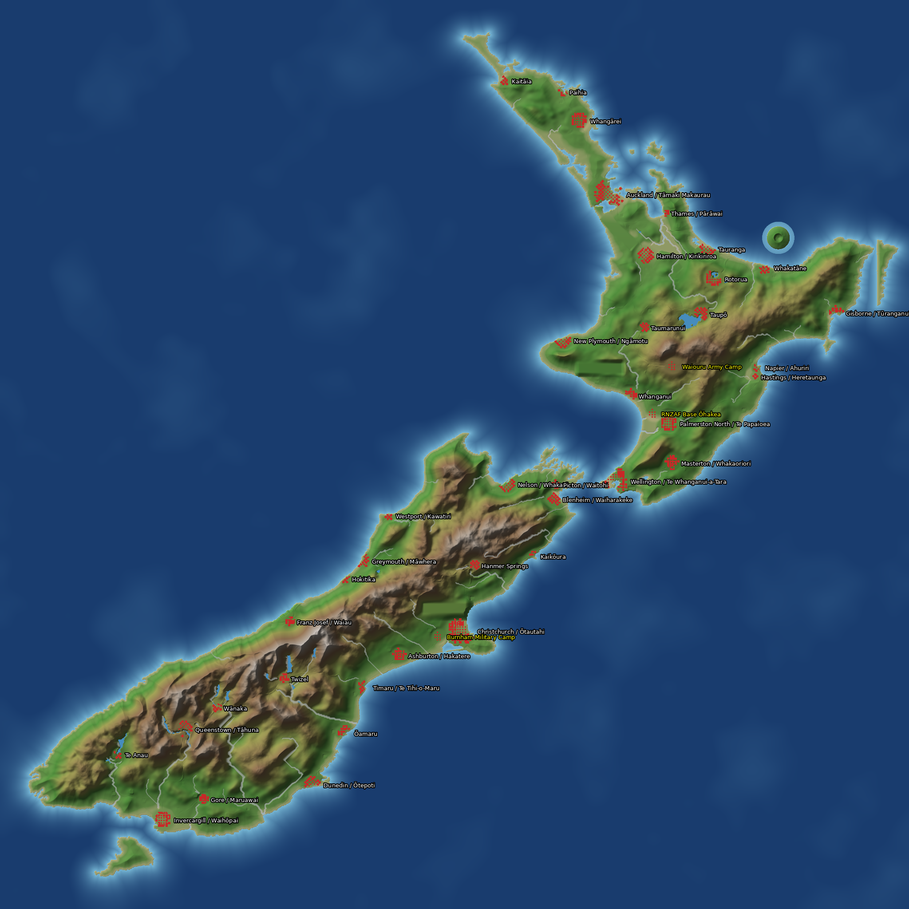
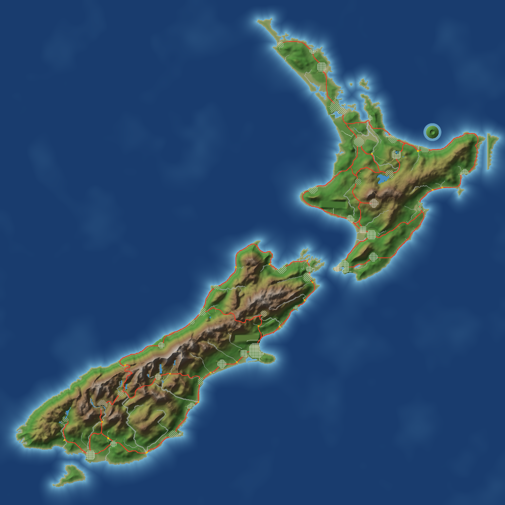
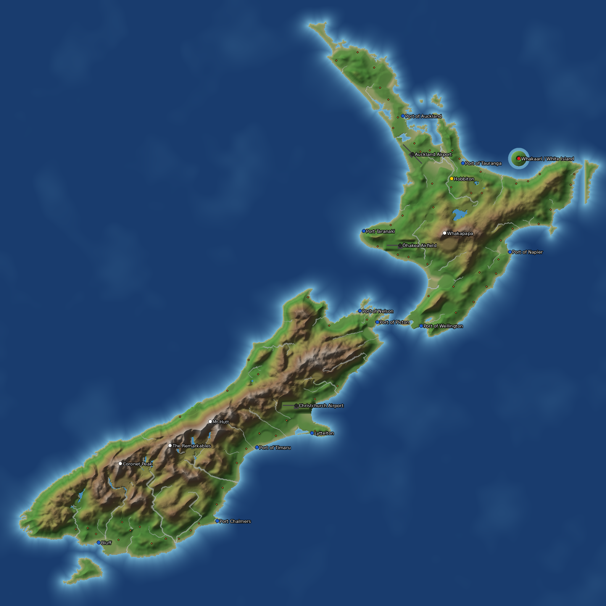
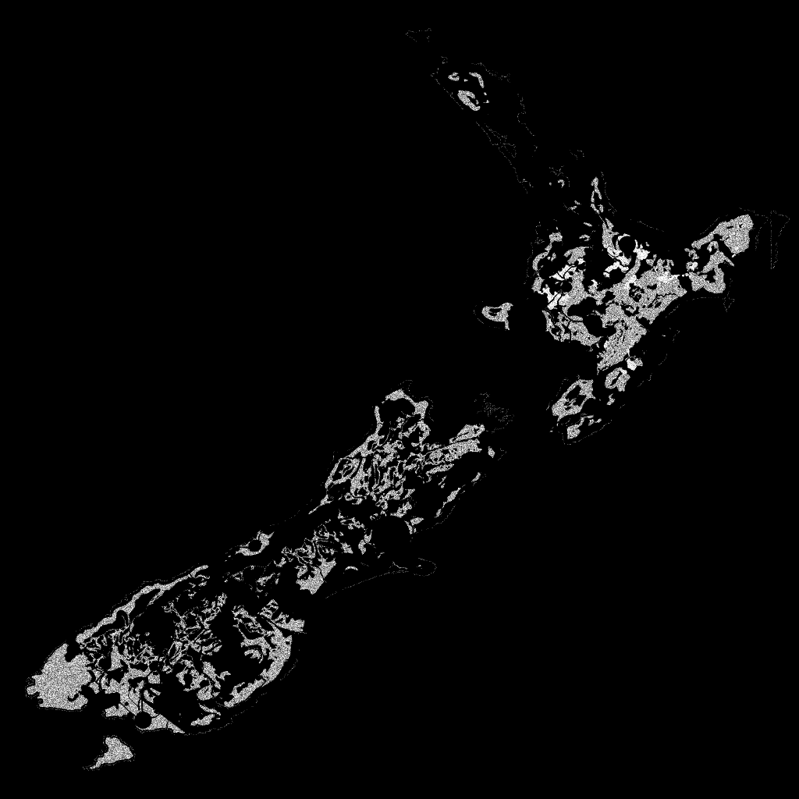

# Aotearoa (DayZ terrain)

A 20 km DayZ terrain based on New Zealand, for a new server. The coastline and the big landforms come from real elevation data, so you can pick out the Southern Alps, Fiordland, the Canterbury Plains, Banks Peninsula, the central volcanic plateau, Taranaki and Stewart Island. On top of that the repo generates:

- 42 towns and bases with bilingual labels
- state highways and town streets
- lakes and rivers
- airfields, ports, ski fields, Hobbiton, farms and Whakaari / White Island
- forests
- a satellite texture coloured from a real satellite photo
- the server mission files


## Quick start (Windows)

1. Install [Python 3.10 or newer](https://www.python.org/downloads/) and tick "Add python.exe to PATH".
2. Double-click `setup.bat` once.
3. Double-click `build_all.bat`. It writes the large files that are too big to commit:
   - `source\heightmap_4096.asc`
   - `source\mask_20480.png`
   - `source\satellite_20480.png`
   - the mission files

   It takes about 20 minutes and 6 GB of memory. Run `build_all.bat regen` to rebuild the whole terrain from the elevation data first.
4. Follow [Terrain Builder setup](#terrain-builder-setup), then [Packing the mod](#packing-the-mod) and [Server setup](#server-setup).

## Scale

| | |
|---|---|
| Terrain size | 20480 m x 20480 m |
| Heightmap grid | 4096 x 4096, 5 m cells |
| Real to game | 1 game metre is about 75 real metres north-south |
| Land area | about 69 km2 (17% of the square) |
| Highest point | 447 m (Southern Alps) |
| Steepest slope | 40 degrees on dry land |

New Zealand is about 1500 km long, so a 20 km map shrinks it a lot, and real heights would make every range a cliff. Heights are scaled down far more than distances, then capped at 40 degrees so players can still climb the hills.

The country keeps its true north-up layout. It is stretched 1.4 times east-west, which makes the islands wider and fills the square map: the real country is about 1.4 times taller than it is wide. Change `STRETCH_X` in `tools/generate_terrain.py` to make it narrower. The settings for turning the map, bending the North Island and widening the islands along their length are still there, all switched off. `heightmap.json` records them.

## What's on the map

### Towns



42 places from `tools/towns.csv`, with about 1,900 buildings:

- Main cities: Auckland, Wellington, Christchurch
- Cities: Hamilton, Tauranga, Dunedin, Palmerston North, Napier, Nelson, Rotorua, New Plymouth, Whangārei, Invercargill, Queenstown
- Towns and villages: Hastings, Whanganui, Gisborne, Blenheim, Picton, Kaikōura, Taupō, Timaru, Ōamaru, Greymouth, Westport, Hokitika, Franz Josef, Masterton, Ashburton, Wānaka, Te Anau, Gore, Twizel, Hanmer Springs, Kaitāia, Paihia, Whakatāne, Thames, Taumarunui
- Military bases: Waiouru Army Camp, Burnham Military Camp, RNZAF Base Ōhakea

Map labels show both names where a town has a separate te reo Māori name, for example "Christchurch / Ōtautahi" and "Queenstown / Tāhuna". Places whose name is already Māori, like Rotorua and Taupō, show one name. Edit the `maori` column in `tools/towns.csv` to change a label.

Each town is placed from its real latitude and longitude:

- A coastal town is moved inland until at least 70% of it is on land.
- Neighbouring towns are shrunk so they don't overlap.
- The ground is flattened to a tilt of 3 degrees or less.
- Buildings sit on a grid of 45 m blocks with 12 m streets. Hospital, police, fire station, church and pub are nearest the middle, then tenements and offices in the cities, then houses.

Towns are much bigger than true scale would give, so they're worth looting. To add, remove or resize a place, edit `tools/towns.csv` (tiers: `capital`, `city`, `town`, `village`, `military`) and regenerate.

Close-ups (1 px per metre): [Auckland](preview/town_auckland.png), [Wellington](preview/town_wellington.png), [Christchurch](preview/town_christchurch.png), [Queenstown](preview/town_queenstown.png).

### Roads



There are 98 km of state highway, 116 km of town streets and 11 km of tracks to sites. Highways follow the real links:

- SH1 the length of both islands, through Waiouru, Burnham and Ōhakea
- SH2 round the east coast
- SH3, SH4 and SH5 in the North Island
- SH6 down the West Coast and over Haast Pass to Wānaka and Queenstown
- SH7 over Lewis Pass and SH73 over Arthur's Pass
- SH8 and SH83 through the Mackenzie Country
- SH94 to Te Anau, plus a few links between

Each leg is a least-cost route. It prefers grades under 8%, never crosses the sea or a lake, avoids crossing rivers, enters towns along their streets, and reuses roads already built so highways share corridors. Highways outside towns are cut into the terrain as a smooth road bed.

- `data/roads/roads.shp` holds the centrelines in Terrain Builder coordinates. The `ID` field picks the road type in `data/roads/RoadsLib.cfg` (1 highway 8 m, 2 street 6 m, 3 track 4 m), and the `REF` field holds the highway number or town.
- `config.cpp` points `newRoadsShape` at the shapefile for the in-game map.
- The satellite has every road painted on, so roads are visible and drivable before any road objects are placed. For proper road surfaces, lay road parts along the shapes with Terrain Builder's road tool.
- `source/roads.json` has the same lines plus 30 points where a highway crosses a riverbed and needs a bridge.

### Water

Lakes come from the real elevation data, where lake surfaces are stored perfectly flat: Taupō, Rotorua, Tarawera, Waikaremoana, Wakatipu, Wānaka, Hāwea, Te Anau, Manapōuri, Pukaki, Tekapo, Ōhau, Benmore and others. Each one is dug as a basin with a rim. `source/lakes.json` gives each lake's water level and shoreline for placing water surfaces in Terrain Builder. Pukaki, Tekapo and Ōhau are painted glacial turquoise on the satellite.

River courses are traced on the real drainage (Waikato, Whanganui, Clutha, Waitaki, Rakaia, Waimakariri and more). They are cut as shallow gravel beds that always run downhill and drop below sea level at the mouth, where the sea fills them. `source/water_4096.png` has lakes in red and riverbeds in green.

### Points of interest



| Site | What's there |
|---|---|
| Auckland Airport, Christchurch Airport, Ōhakea Airfield | 900 m runway, apron, two hangars, service hangar, tower |
| 11 ports (Auckland, Wellington, Lyttelton, Port Chalmers, Tauranga, Napier, Picton, Nelson, Bluff, Timaru, Port Taranaki) | Concrete pad on the shore, container rows, warehouse |
| The Remarkables, Coronet Peak, Mt Hutt, Whakapapa | Lodge, car park and a lift line up the fall line |
| Hobbiton | A ring of cottages and the Green Dragon (hobbit holes need a custom model) |
| 70 farms | Farmhouse, barn or cowshed and shed, along the highways |
| Whakaari / White Island | Volcanic islet off the Bay of Plenty with a crater and a contaminated zone |

Every site is fitted onto dry, open land clear of towns, roads and water, flattened, and joined to the nearest road. Labels for the named sites are in `config/names.hpp`. Close-ups: [Christchurch Airport](preview/satellite_christchurchairport.png), [Lyttelton](preview/satellite_lyttelton.png).

### Forests



There are about 234,000 trees and bushes. Native bush is an irregular mix of broadleaf trees with an understorey and a bushy edge. Pine is planted in straight rows like radiata plantations, with each stand turned its own way. Trees stay off roads, towns, sites, water and slopes over 38 degrees.

### Surfaces

| Layer | Colour | Where |
|---|---|---|
| beach | 255,230,140 | Low coast up to 45 m inland, lake beds, and everything under the sea |
| pasture | 120,190,60 | Default lowland grass, and the ground inside towns |
| farmland | 200,200,90 | Flat low ground, e.g. Canterbury and Waikato |
| bush | 20,90,30 | Steep hills and the wet West Coast |
| pine | 60,110,70 | Plantation forest in the North Island hills |
| tussock | 190,160,80 | South Island high country east of the main divide |
| scree | 150,150,150 | High alpine ground, riverbeds, runways and yards |
| rock | 90,80,75 | Anything steeper than 36 degrees |
| volcanic | 120,60,50 | Central plateau and Whakaari |

The material paths in `layers.cfg` point at vanilla `DZ\surfaces\data\terrain` files. Check that each one exists on your P: drive before you generate layers, and swap any that don't. Terrain Builder allows only a few surfaces per tile, so if layer generation reports too many surfaces on a tile, merge similar layers (for example, farmland into pasture).

### Satellite texture


A satellite photo is far too coarse to use directly: at 20 km, one pixel of a full-country photo covers about 30 m of the map. So the photo supplies the regional colour (olive Waikato, brown Canterbury and Otago high country, dark Fiordland), and each surface layer adjusts it. On top of that the builder adds:

- light and shade from the heightmap
- small-scale texture and canopy speckle
- snow above about 330 m
- sea and lake colour by depth, and braided water in the riverbeds
- roads, runways with markings, port pads and yards
- a rooftop for every building

The photo is not stored in this repo; only the colours taken from it are. To use a different north-up photo of New Zealand, run `python tools/sample_photo_colours.py photo.png`, then `build_satellite.py`. It prints how well the coastlines matched (the current photo matched 0.92 out of 1). The style of each layer is set in `LAYER_STYLE` at the top of `build_satellite.py`.

## Files

| Path | What it is |
|---|---|
| `config.cpp`, `$PBOPREFIX$` | World config (`CfgWorlds` class `aotearoa`) and PBO prefix `maps\aotearoa` |
| `config/names.hpp` | Map labels for towns and sites |
| `mod/mod.cpp` | Mod name and description for the `@Aotearoa` folder |
| `data/roads/` | `roads.shp` and `RoadsLib.cfg` |
| `source/heightmap_4096.png` | 16-bit heightmap. Black is `png_black_m` and white is `png_white_m` in `heightmap.json`. |
| `source/heightmap.json` | Height range, grid, projection and reshape details |
| `source/mask_4096.png`, `source/layers.cfg`, `source/mapLegend.png` | Surface mask, its layers and legend |
| `source/water_4096.png`, `source/lakes.json` | Lakes and riverbeds; lake levels and shorelines |
| `source/roads.json`, `source/roads_4096.png` | Road lines and bridge points; road footprint |
| `source/pois.json` | Sites, their paved areas, lift lines and the Whakaari zone |
| `source/towns.csv` | Generated town positions in world and Terrain Builder coordinates |
| `source/objects/*_tb.txt` | Terrain Builder object imports: towns, sites, forest |
| `source/objects/*_spawner.json` | Town and site buildings as DayZ object spawner files |
| `source/sat_tint_512.png` | Regional colour taken from the satellite photo, in map space |
| `mission/` | Server mission files and a `serverDZ.cfg` template |
| `preview/` | Satellite, relief, mask, slope, towns, roads, sites, forest and mission maps |
| `tools/` | The generators (see [Regenerating](#regenerating)) |

Not committed, because they are too big: `source/heightmap_4096.asc` (about 115 MB), `source/mask_20480.png` and `source/satellite_20480.png`. `build_all.bat` makes them.

## Terrain Builder setup

These steps assume DayZ Tools is installed and the P: drive is mounted with game data extracted.

1. Copy this repo to `P:\maps\aotearoa` and run `build_all.bat`.
2. In Terrain Builder, create a new project at `P:\maps\aotearoa\source`.
3. Open **Mapframe Properties** and set:
   - Location: easting **200000**, northing **0**
   - Samplers: grid size **4096 x 4096**, cell size **5 m**, terrain size **20480 m**
   - Satellite and surface mask image size: **20480 x 20480** (1 m per pixel)
   - Tile size **512**, desired overlap **16**
   - Output root: `P:\maps\aotearoa\data\layers`
4. **Import Terrain** and choose `source\heightmap_4096.asc`.
5. Import `source\satellite_20480.png` as the satellite image and `source\mask_20480.png` as the surface mask.
6. Point the layers config at `source\layers.cfg`.
7. **Import Objects** from each file in `source\objects`:
   - `towns_tb.txt`
   - `pois_tb.txt`
   - `forest_tb.txt` (large, so give it a layer of its own)

   Do this once your template library has the models.
8. Import `data\roads\roads.shp` as a shape layer if you want to lay road parts along it.
9. Add water surfaces for the lakes at the levels in `source\lakes.json`.
10. **Generate Layers**, then **Export WRP** to `P:\maps\aotearoa\world\aotearoa.wrp`.

## Packing the mod

1. In Addon Builder, pack `P:\maps\aotearoa` to `@Aotearoa\addons\aotearoa.pbo` with the prefix `maps\aotearoa`.
   - Leave out `source\`, `tools\`, `preview\` and `mission\`. They are inputs, not game data.
   - Keep `config.cpp`, `config\`, `data\` and `world\`.
2. Copy `mod\mod.cpp` into `@Aotearoa\`.
3. Sign the PBO with your key if the server verifies signatures.

The world inherits lighting, weather and sounds from Chernarus Plus. It sets a southern latitude (41.5 degrees south), a 20 km map grid and a January start date.

## Server setup

`tools/build_mission.py` (step 5 of `build_all.bat`) writes `mission/dayzOffline.aotearoa`:

| File | What it holds |
|---|---|
| `init.c` | Vanilla start-up, with the date kept in the southern summer and the loot export line (see below) |
| `cfgplayerspawnpoints.xml` | 40 spawn bubbles spread along the coasts of the two main islands |
| `cfgeventspawns.xml` | Cars on the highway verges, boats off the ports, heli crashes in open country, police cars in town streets, military convoys near the bases |
| `env/zombie_territories.xml` | Infected zones: city, village and military in towns, industrial at ports and airfields, solitude at farms |
| `cfgeffectarea.json` | The Whakaari contaminated zone and the mainland safe positions |
| `cfggameplay.worldsdata.json` | `WorldsData` to merge into `cfggameplay.json`: object spawners and New Zealand temperatures |

`mission/serverDZ.cfg` is a server config template pointing at the mission.

To set up a server:

1. Copy vanilla `mpmissions\dayzOffline.chernarusplus` to `mpmissions\dayzOffline.aotearoa`. Copy the generated files over it.
2. Merge `cfggameplay.worldsdata.json` into the mission's `cfggameplay.json`.
3. Start the server with `-mod=@Aotearoa` and `serverDZ.cfg`.
4. Export the loot positions:
   1. Uncomment the `ExportProxyData` line in `init.c`.
   2. Start the server once.
   3. Copy `storage_1\export\mapgrouppos.xml` into the mission folder.
   4. Comment the line out again.

   Loot won't spawn in buildings until you do this.
5. The animal territory files in `env\` still have Chernarus positions. Replace their zones, or empty them for the species New Zealand doesn't have (wolves and bears).

The economy (`db\types.xml` and the rest) is vanilla until you decide how loot-heavy the server should be.

## Things to check on your P: drive

Class and model names here are vanilla DayZ names that haven't been checked against a real P: drive yet. If one doesn't match, Terrain Builder skips the object or the server logs a missing class. The lists are at the top of each file:

| Where | What |
|---|---|
| `tools/towns.py` | Town buildings (`Land_House_1W01` and so on). Terrain Builder uses the model name in lowercase (`land_house_1w01` becomes `house_1w01`). |
| `tools/pois.py` | Hangars, tower, containers, warehouse, barns, lift towers |
| `tools/forests.py` | Tree and bush models from `DZ\plants` |
| `data/roads/RoadsLib.cfg` | Road textures and materials (placeholders) |
| `source/layers.cfg` | Surface materials |

The Terrain Builder object format is `"template";x;y;yaw;pitch;roll;scale;z offset;`, with the 200000 easting already added. Town grids and site layouts are turned in steps of 45 degrees, so buildings line up whichever way the engine counts yaw.

`config/names.hpp` is UTF-8 with macrons. If a macron shows as a box on the in-game map, the map font is missing that character. Remove the macrons from the `maori` and `name` columns in `tools/towns.csv` and regenerate.

## Regenerating

```bash
pip install -r tools/requirements.txt
python tools/generate_terrain.py      # terrain, water, towns, roads, sites, forest, 4096 mask, previews
python tools/build_satellite.py --size 20480
python tools/upscale_mask.py 20480
python tools/png_to_asc.py
python tools/build_mission.py
```

`generate_terrain.py` downloads [Terrarium elevation tiles](https://registry.opendata.aws/terrain-tiles/) from AWS Open Data into `~/.cache/aotearoa-tiles`. The tiles mix SRTM, GEBCO, LINZ and other sources. It takes about 5 minutes. Each part has its own module and its own settings at the top of the file:

| Module | Settings |
|---|---|
| `generate_terrain.py` | Shape and height: `ROTATION_DEG`, `NI_BEND_DEG`, `WIDEN`, `MAX_HEIGHT`, `MAX_SLOPE_DEG`, `MIDDLE_WEIGHT`, `COAST_RAMP_M`, `SEED` |
| `water.py` | Lake detection, river size (`RIVER_MIN_CATCHMENT_KM2`) and depth |
| `towns.py` | Town tiers, block size and building lists |
| `roads.py` | The highway list (`HIGHWAYS`), road widths and routing costs |
| `pois.py` | Airfields, ports, ski fields, Hobbiton, Whakaari, farm count |
| `forests.py` | Tree lists and spacing |
| `build_mission.py` | Spawn, vehicle and crash counts, infected zone density, temperatures |
