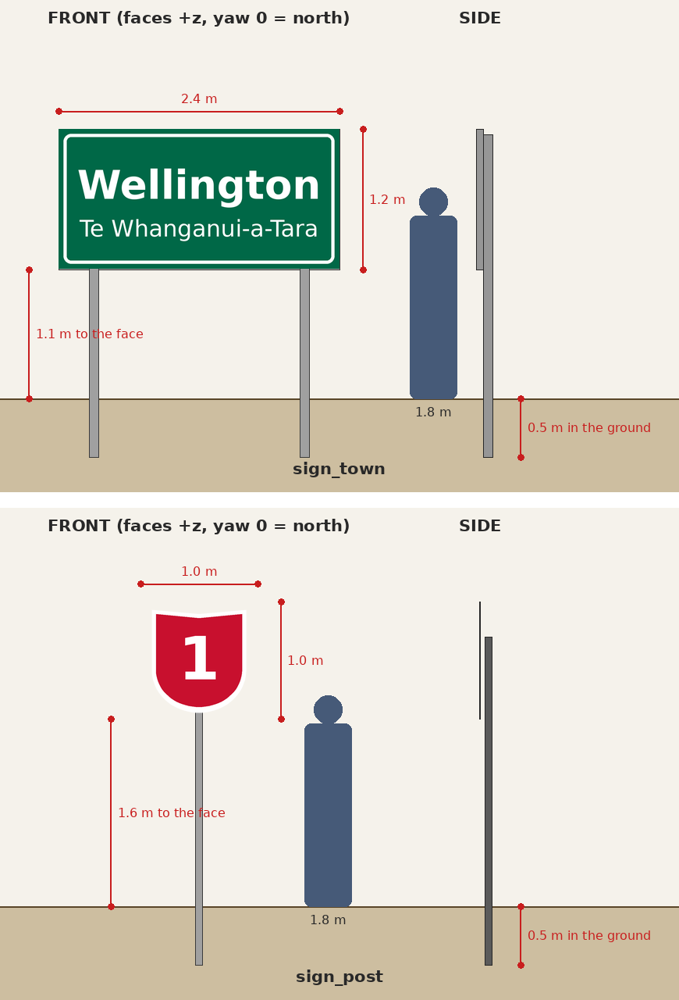

# Brief: two road sign models for Aotearoa

Two very simple static models carry all 797 road signs on the map. Everything else is done: the
textures, materials, config classes and positions are all generated. Each sign swaps its texture
through the `camo` hidden selection. Expect an hour or two in Object Builder for both.

## What to make

| Model | Size | Save as | Signs using it |
|---|---|---|---|
| `sign_town` | 2.4 x 1.2 m green board on two 80 mm posts, face 1.1 m above the ground | `P:\maps\aotearoa\structures\sign_town\sign_town.p3d` | 136 place-name signs |
| `sign_post` | 1 m square cut-out face on one 60 mm post, face 1.6 m above the ground | `P:\maps\aotearoa\structures\sign_post\sign_post.p3d` | 661 shields, speed, Give Way and One Lane Bridge signs |

Both posts go 0.5 m into the ground, so they sit right on slopes. The face looks along +z, which is north at yaw 0.

## Files you get

In the release's `models` zip, or in the repo:

| File | Use |
|---|---|
| `docs/models/sign_town.obj`, `sign_post.obj` | Resolution LOD, with UVs set and the `camo` group |
| `docs/models/sign_town_geometry.obj`, `sign_post_geometry.obj` | Geometry LOD: closed convex boxes, one group per component |
| `data/signs/sign_town.rvmat` | Material for the board (Super shader) |
| `data/signs/sign_post.rvmat` | The same, alpha tested, so the shield, circle, triangle and diamond outlines cut out |
| `data/signs/sign_Wellington.png`, `post_SH1.png` | Stand-in textures. Each sign's own one is applied by config. |
| `preview/signs_reference.png` | The views above |

Texture layout: the face is the top half of the texture. The bottom half is the grey back, which the
posts also use. `sign_town` textures are 1024 x 1024 with no alpha (`_co`). `sign_post` textures are
512 x 1024 with alpha (`_ca`). `pack.bat` converts them.

## LODs

| LOD | From | Notes |
|---|---|---|
| Resolution 0 | `<name>.obj` | Name the `camo` group's faces as selection **`camo`**. Material: the rvmat above. Texture: the stand-in `.paa`. |
| Resolution 1 (optional) | the same | Not needed: these are 12 and 26 faces |
| Geometry | `<name>_geometry.obj` | Name the selections `Component01`, `Component02`, and so on. Mass about 40 kg (`sign_town`) and 15 kg (`sign_post`). Property `class` = `house`. |
| Fire Geometry | copy of Geometry | So bullets hit the post and board |
| View Geometry | copy of Geometry | |
| Shadow Volume 0 | copy of Geometry | Closed boxes, so they make a valid shadow volume |

No Memory, Roadway or Paths LOD is needed.

## Config, already written

`config/signs.hpp` has a base class per model, such as `Land_Aotearoa_Sign_Base` with
`model = "\maps\aotearoa\structures\sign_town\sign_town.p3d"` and `hiddenSelections[] = {"camo"}`.
It also has one class per sign that sets `hiddenSelectionsTextures`. Don't rename the selection or
the paths.

## Done when

1. Both `.p3d` files are at the paths above.
2. `pack.bat` no longer prints "No structures/sign_town/sign_town.p3d" or the `sign_post` note. It then loads `signs_spawner.json` and `roadsigns_spawner.json`.
3. In game, at the Wellington sign by SH1 or any SH1 shield:
   - the face reads correctly from the road (if you see the back, rotate the model 180°; if the text is mirrored, flip the face UVs);
   - the cut-out outlines show no grey square;
   - a car stops against the post.
